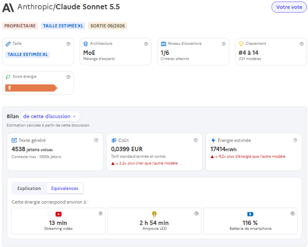

## Prompt

Génère le code d'une page HTML avec du CSS et du Javascript pour simuler le fonctionnement d'un éclairage par va et vient électrique. Une ampoule L s'allume si on clique sur un switch A pour l'activer et qu'on ne clique pas sur un switch B ou si on clique sur le switch B et qu'on ne clique pas sur le switch A , sinon l'ampoule L reste éteinte.

## Raisonnement de Anthropic/Claude Sonnet 5.5

I'm planning a French HTML page that simulates a two-way switch circuit, where the lamp turns on when exactly one switch is flipped. The layout will use an SVG schematic with two switches, wires, a lamp and a source, with clicks toggling the switches, a truth table highlighting the active row, and animated current flow along the wires. Now I'm working out how a real two-way setup with two travelers should be drawn.

Now I'm settling the wiring: crossing the two travelers, so the lamp lights only when exactly one switch sits in the active position. I'm mapping each switch contact to its counterpart on the other switch and checking every combination to confirm it gives XOR.

Still writing the SVG coordinates...

Still working out the lever geometry: the B lever pivots at the common point and swings around so it reaches the upper or lower contact, and I'm checking the rotation direction so the animation sweeps the right way.

Still working out the lever rotations: pointing the B lever left means clockwise turns it up, so B1 is +41° and B2 is -41°, and the A lever is mirrored. Now I'm defining how the wires light up, with the source feed always live, the traveler matching A's position carrying current, and the lamp only powered when B's lever meets that same traveler.

Still writing the SVG layout: the source battery sits on the left, and the return path runs along the bottom back to it.

Still placing the source, battery and return path around the lamp.

Still writing the SVG wires: the lamp's glass, filament and glow filter come next, and the wires get an "on" class for voltage and a "flow" class with animated dashes when the lamp is lit.

Still writing the SVG code...

Still writing the lever logic and the live-wire conditions...

Still writing the SVG lever markup and the click handling.

## Bilan



## Résultat

```html
<!DOCTYPE html>
<html lang="fr">
<head>
<meta charset="UTF-8">
<meta name="viewport" content="width=device-width, initial-scale=1">
<title>Simulation d'un va-et-vient électrique</title>
<style>
  :root{
    --bg-off:#1b1f2a;
    --bg-on:#3b3a2a;
    --wire:#6b7280;
    --live:#ffb300;
    --card:#262c3a;
    --text:#e5e7eb;
    --accent:#4fc3f7;
  }
  *{box-sizing:border-box}
  body{
    margin:0;
    min-height:100vh;
    font-family:"Segoe UI",Arial,sans-serif;
    color:var(--text);
    background:var(--bg-off);
    display:flex;
    flex-direction:column;
    align-items:center;
    padding:20px;
    transition:background .5s;
  }
  body.lit{ background:radial-gradient(circle at 85% 40%, #6d6230 0%, var(--bg-on) 60%); }

  h1{margin:.2em 0 .1em;font-size:1.7rem;text-align:center}
  p.sub{margin:0 0 15px;opacity:.75;text-align:center;max-width:700px}

  .card{
    background:var(--card);
    border-radius:14px;
    padding:15px;
    box-shadow:0 8px 25px rgba(0,0,0,.35);
    width:100%;
    max-width:900px;
  }
  svg{width:100%;height:auto;display:block}

  /* Fils */
  .wire{fill:none;stroke:var(--wire);stroke-width:5;stroke-linecap:round;stroke-linejoin:round;transition:stroke .25s}
  .wire.on{stroke:var(--live)}
  .wire.flow{stroke-dasharray:12 10;animation:flow .6s linear infinite}
  @keyframes flow{to{stroke-dashoffset:-22}}

  /* Interrupteurs */
  .switch{cursor:pointer}
  .lever{stroke:#cfd8dc;stroke-width:7;stroke-linecap:round;transition:stroke .25s}
  .lever.on{stroke:var(--live)}
  .lever-rot{transition:transform .3s cubic-bezier(.4,1.6,.5,1)}
  .contact{fill:#37474f;stroke:#b0bec5;stroke-width:3}
  .pivot{fill:#b0bec5;stroke:#37474f;stroke-width:3}
  .label{fill:var(--text);font-size:15px;font-weight:600}
  .small{fill:#9aa5b1;font-size:12px}
  .state{fill:var(--accent);font-size:14px;font-weight:600}
  .switch:hover .pivot{fill:var(--accent)}

  /* Ampoule */
  #glass{fill:#2c3342;stroke:#b0bec5;stroke-width:3;transition:fill .3s}
  #filament{fill:none;stroke:#78909c;stroke-width:3;stroke-linecap:round;transition:stroke .3s}
  #glow{opacity:0;transition:opacity .35s}
  .lamp-lit #glass{fill:#fff3b0}
  .lamp-lit #filament{stroke:#ff9800}
  .lamp-lit #glow{opacity:1}

  /* Commandes */
  .controls{display:flex;flex-wrap:wrap;gap:12px;justify-content:center;margin:16px 0 4px}
  button{
    background:#37425a;color:var(--text);border:2px solid transparent;
    padding:10px 18px;border-radius:10px;font-size:1rem;cursor:pointer;
    transition:.2s;
  }
  button:hover{border-color:var(--accent)}
  button.active{background:var(--accent);color:#102030;font-weight:700}

  .status{
    text-align:center;font-size:1.15rem;font-weight:700;margin:10px 0 0;min-height:1.5em;
  }
  .status.on{color:#ffd54f}

  table{border-collapse:collapse;margin:18px auto 4px;min-width:280px}
  th,td{border:1px solid #475066;padding:7px 18px;text-align:center}
  th{background:#323a4e}
  tr.current td{background:#4fc3f733;font-weight:700}
  td.l1{color:#ffd54f;font-weight:700}
  .hint{text-align:center;opacity:.65;font-size:.9rem;margin-top:10px}
</style>
</head>
<body>

<h1>💡 Simulateur de va-et-vient</h1>
<p class="sub">L'ampoule <b>L</b> s'allume si on active le switch <b>A</b> sans activer <b>B</b>, ou si on active <b>B</b> sans activer <b>A</b>. Sinon elle reste éteinte&nbsp;: L = A ⊕ B.</p>

<div class="card">
  <svg id="schema" viewBox="0 0 820 420" role="img" aria-label="Schéma d'un va-et-vient">
    <defs>
      <radialGradient id="halo">
        <stop offset="0%" stop-color="#fff59d" stop-opacity=".95"/>
        <stop offset="60%" stop-color="#ffca28" stop-opacity=".35"/>
        <stop offset="100%" stop-color="#ffca28" stop-opacity="0"/>
      </radialGradient>
    </defs>

    <!-- ===== Fils ===== -->
    <!-- Source + vers commun de A -->
    <path id="wSrc"  class="wire" d="M80 210 L180 210"/>
    <!-- Navettes (fils croisés) : A1 -> B2  et  A2 -> B1 -->
    <path id="wT1"   class="wire" d="M260 140 L320 140 L480 280 L540 280"/>
    <path id="wT2"   class="wire" d="M260 280 L320 280 L480 140 L540 140"/>
    <!-- Commun de B vers lampe -->
    <path id="wLamp" class="wire" d="M620 210 L690 210"/>
    <!-- Retour -->
    <path id="wRet"  class="wire" d="M750 210 L785 210 L785 385 L50 385 L50 250"/>

    <!-- ===== Source ===== -->
    <rect x="20" y="170" width="60" height="80" rx="8" fill="#37425a" stroke="#b0bec5" stroke-width="3"/>
    <text x="50" y="198" text-anchor="middle" class="label" style="font-size:22px">+</text>
    <text x="50" y="232" text-anchor="middle" class="label" style="font-size:22px">−</text>
    <text x="50" y="160" text-anchor="middle" class="small">Source</text>

    <!-- ===== Switch A ===== -->
    <g class="switch" id="swA" tabindex="0" role="button" aria-label="Switch A">
      <rect x="150" y="110" width="140" height="200" fill="transparent"/>
      <circle class="contact" cx="260" cy="140" r="9"/>
      <circle class="contact" cx="260" cy="280" r="9"/>
      <g transform="translate(180 210)">
        <g class="lever-rot" id="rotA">
          <line class="lever" id="leverA" x1="0" y1="0" x2="106" y2="0"/>
        </g>
      </g>
      <circle class="pivot" cx="180" cy="210" r="10"/>
      <text x="215" y="115" class="small" text-anchor="middle">position 1</text>
      <text x="215" y="310" class="small" text-anchor="middle">position 2</text>
    </g>
    <text x="200" y="70" class="label" text-anchor="middle" style="font-size:20px">Switch A</text>
    <text x="200" y="92" class="state" text-anchor="middle" id="stA">désactivé</text>

    <!-- ===== Switch B ===== -->
    <g class="switch" id="swB" tabindex="0" role="button" aria-label="Switch B">
      <rect x="510" y="110" width="140" height="200" fill="transparent"/>
      <circle class="contact" cx="540" cy="140" r="9"/>
      <circle class="contact" cx="540" cy="280" r="9"/>
      <g transform="translate(620 210)">
        <g class="lever-rot" id="rotB">
          <line class="lever" id="leverB" x1="0" y1="0" x2="-106" y2="0"/>
        </g>
      </g>
      <circle class="pivot" cx="620" cy="210" r="10"/>
      <text x="585" y="115" class="small" text-anchor="middle">position 1</text>
      <text x="585" y="310" class="small" text-anchor="middle">position 2</text>
    </g>
    <text x="580" y="70" class="label" text-anchor="middle" style="font-size:20px">Switch B</text>
    <text x="580" y="92" class="state" text-anchor="middle" id="stB">désactivé</text>

    <!-- ===== Ampoule ===== -->
    <g id="lamp">
      <circle id="glow" cx="720" cy="210" r="95" fill="url(#halo)"/>
      <circle id="glass" cx="720" cy="210" r="32"/>
      <path id="filament" d="M700 225 L708 198 L716 222 L724 198 L732 222 L740 198"/>
      <text x="720" y="268" text-anchor="middle" class="label" style="font-size:20px">L</text>
    </g>
  </svg>

  <div class="controls">
    <button id="btnA">Switch A : désactivé</button>
    <button id="btnB">Switch B : désactivé</button>
    <button id="btnReset">Réinitialiser</button>
  </div>

  <p class="status" id="status"></p>

  <table>
    <thead><tr><th>A</th><th>B</th><th>L</th></tr></thead>
    <tbody>
      <tr data-a="0" data-b="0"><td>0</td><td>0</td><td>0</td></tr>
      <tr data-a="0" data-b="1"><td>0</td><td>1</td><td class="l1">1</td></tr>
      <tr data-a="1" data-b="0"><td>1</td><td>0</td><td class="l1">1</td></tr>
      <tr data-a="1" data-b="1"><td>1</td><td>1</td><td>0</td></tr>
    </tbody>
  </table>
  <p class="hint">Cliquez sur les interrupteurs (ou les boutons, ou les touches A / B du clavier).</p>
</div>

<script>
  // État des interrupteurs : false = désactivé (position 1), true = activé (position 2)
  const state = { A: false, B: false };

  const $ = id => document.getElementById(id);
  const ANGLE = 41.2; // angle du levier en degrés

  function setClass(el, cls, on){ el.classList.toggle(cls, on); }

  function update(){
    const a = state.A, b = state.B;

    // Rotation des leviers
    // A (levier vers la droite) : position 1 = haut, position 2 = bas
    $("rotA").style.transform = `rotate(${a ?  ANGLE : -ANGLE}deg)`;
    // B (levier vers la gauche) : position 1 = haut, position 2 = bas
    $("rotB").style.transform = `rotate(${b ? -ANGLE :  ANGLE}deg)`;

    // Logique : L = A XOR B  (navettes croisées)
    const lit = a !== b;

    // Tension présente sur les fils
    // Navette 1 (A1 -> B2) sous tension si A en position 1 ; navette 2 (A2 -> B1) si A en position 2
    setClass($("wSrc"), "on", true);
    setClass($("wT1"), "on", !a);
    setClass($("wT2"), "on",  a);
    setClass($("wLamp"), "on", lit);
    setClass($("wRet"), "on", lit);
    setClass($("leverA"), "on", true);
    setClass($("leverB"), "on", lit);

    // Courant circulant (animation) : uniquement si le circuit est fermé
    setClass($("wSrc"), "flow", lit);
    setClass($("wT1"), "flow", lit && !a);
    setClass($("wT2"), "flow", lit &&  a);
    setClass($("wLamp"), "flow", lit);
    setClass($("wRet"), "flow", lit);

    // Ampoule et ambiance
    setClass($("lamp"), "lamp-lit", lit);
    setClass(document.body, "lit", lit);

    // Textes
    $("stA").textContent = a ? "activé" : "désactivé";
    $("stB").textContent = b ? "activé" : "désactivé";
    $("btnA").textContent = "Switch A : " + (a ? "activé" : "désactivé");
    $("btnB").textContent = "Switch B : " + (b ? "activé" : "désactivé");
    setClass($("btnA"), "active", a);
    setClass($("btnB"), "active", b);

    const st = $("status");
    st.textContent = lit ? "💡 L'ampoule est ALLUMÉE" : "L'ampoule est ÉTEINTE";
    setClass(st, "on", lit);

    // Table de vérité
    document.querySelectorAll("tbody tr").forEach(tr => {
      tr.classList.toggle("current",
        (tr.dataset.a === "1") === a && (tr.dataset.b === "1") === b);
    });
  }

  const toggle = k => { state[k] = !state[k]; update(); };

  $("swA").addEventListener("click", () => toggle("A"));
  $("swB").addEventListener("click", () => toggle("B"));
  $("btnA").addEventListener("click", () => toggle("A"));
  $("btnB").addEventListener("click", () => toggle("B"));
  $("btnReset").addEventListener("click", () => { state.A = state.B = false; update(); });

  // Accessibilité clavier
  ["swA","swB"].forEach(id => {
    $(id).addEventListener("keydown", e => {
      if(e.key === "Enter" || e.key === " "){
        e.preventDefault();
        toggle(id === "swA" ? "A" : "B");
      }
    });
  });
  document.addEventListener("keydown", e => {
    if(e.target.tagName === "BUTTON") return;
    if(e.key.toLowerCase() === "a") toggle("A");
    if(e.key.toLowerCase() === "b") toggle("B");
  });

  update();
</script>
</body>
</html>
```

**Fonctionnement**

- Chaque switch est un inverseur à deux positions. Les deux fils « navettes » sont croisés entre A et B.
- Le courant passe donc uniquement lorsque A et B sont dans des positions différentes, soit L = A ⊕ B (OU exclusif).
- La table de vérité met en évidence la ligne correspondant à l'état actuel.
- Les fils sous tension passent en orange et le courant est animé quand le circuit est fermé.
- On peut cliquer sur les interrupteurs du schéma, sur les boutons, ou utiliser les touches **A** et **B** du clavier.